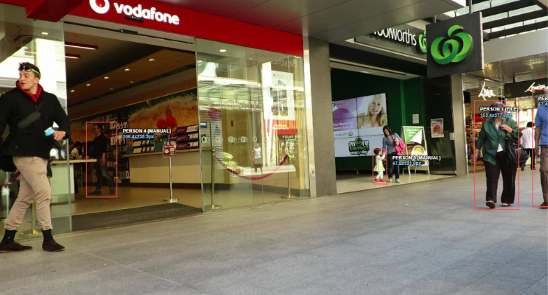
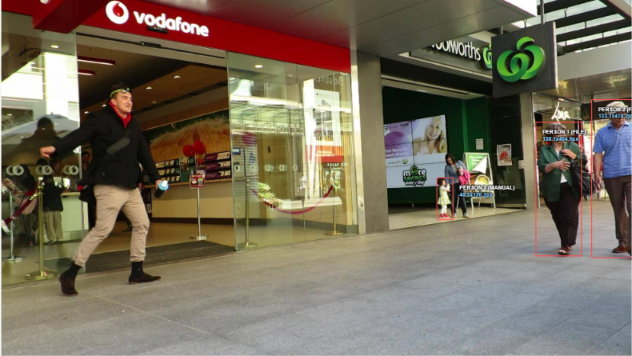
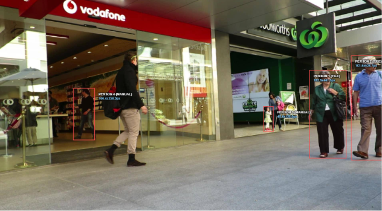

# Báo cáo cá nhân — HoVaTen-MSSV

Đổi tên file theo quy tắc `MSSV_HoTen.md`. Ví dụ: `20241234_NguyenVanAn.md`.

Đoạn video: MOT17-09, 150 frame (frame 1–150), nguồn MOTChallenge, giấy phép CC BY-NC-SA 3.0.

## 0. Thông tin học viên

- Họ tên: Đỗ Thị Kim Oanh
- MSSV: 2A202604034
- Mã đề (A/B/C): A
- Email: 2A202604034
- Link repository: https://github.com/DoThiKimOanhB22DCCN606/K5-L2-DAY05-DoThiKimOanh-202604034-MOTTracking/tree/main
- Giờ bắt đầu: 16:00 13/11/2026
- Giờ kết thúc: 20:00 13/11/2026

## 1. Xem trước đoạn video (CP0)

Ghi **trước khi vẽ**, mỗi người một dòng.

| Mã | Frame CVAT đầu tiên có box trong MOT export | Frame CVAT cuối có box trong MOT export | Rẽ / dừng / đổi tốc độ ở frame | Bị che / cờ trong CVAT export | Ghi chú theo dữ liệu |
|---|---:|---:|---|---|---|
| P1 | 0 | 149 | 0, 10, 20, 30, 50, 60, 70, 80, 90, 100, 110, 120, 130, 140, 149. | Không có box `occluded=1`; `outside=1` tại frame 40 | |
| P2 | 62 | 149 | 62, 72, 82, 92, 102, 112, 120, 122, 132, 142. | Không | |
| P3 | 0 | 149 | 0, 10, 19, 29, 38, 48, 57, 66, 75, 85, 94, 103, 112, 122, 131, 140, 149. | Không | |
| P4 | 0 | 149 | 0, 10, 19, 29, 38, 48, 57, 66, 75, 85, 94, 103, 112, 122, 131, 140, 149. | Không | |
| P5 | 0 | 105 | 0, 3–17, 20, 26, 33, 39, 46, 52, 59, 65, 72, 78, 85, 91, 98, 104, 105. | `occluded=1` ở 104–105, 115–116, 106, 108, 110, 111, 115–117. | |

## 2. Keyframe và thời gian (CP1, CP4)

Số keyframe lấy từ kết quả `src/check_submission.py`.

| Mã | Số keyframe hiển thị | Keyframe ở frame CVAT | Số frame có box trong MOT | Keyframe / 100 frame | Thời gian (phút) | Chỗ khó / ghi chú kiểm toán |
|---|---:|---|---:|---:|---|---|
| P1 | 15 | 0, 10, 20, 30, 50, 60, 70, 80, 90, 100, 110, 120, 130, 140, 149 | 140 | 10.7 | | |
| P2 | 10 | 62, 72, 82, 92, 102, 112, 120, 122, 132, 142 | 88 | 11.4 | | |
| P3 | 17 | 0, 10, 19, 29, 38, 48, 57, 66, 75, 85, 94, 103, 112, 122, 131, 140, 149 | 150 | 11.3 | |
| P4 | 17 | 0, 10, 19, 29, 38, 48, 57, 66, 75, 85, 94, 103, 112, 122, 131, 140, 149 | 150 | 11.3 | |
| P5 | 31 | 0, 3–17, 20, 26, 33, 39, 46, 52, 59, 65, 72, 78, 85, 91, 98, 104, 105 | 106 | 29.2 | | |
| **Tổng** | **90** | — | **634** | **14.2** | | |

Keyframe / 100 frame của cả bài = tổng keyframe ÷ tổng số frame có mặt × 100 = `90 ÷ 634 × 100 = 14.2`.

Bạn đặt keyframe nhiều nhất ở người nào? Vì sao (người đó rẽ, dừng, lại gần camera hay bị che)?
P5 có nhiều keyframe hiển thị nhất (31). Vì P5 bị che rồi ra khỏi khung.

...

## 3. Đoạn bị che (CP2)

Người bị che: `P1`

| Mốc | Frame CVAT theo file hiện có |
|---|---:|
| Bắt đầu bị che một phần (`occluded=1`) | Không |
| Bật `outside` | 40 |
| Có box trở lại / tắt `outside` | 50 |
| Thấy rõ trở lại (`occluded=0`) | 50 |

- Thời gian khuất hẳn: 10 frame = 0.33 giây.
- Quyết định: giữ cùng ID / tạo track mới.
- Lý do (trả lời 3 câu: khuất bao lâu so với 60 frame, ngoại hình có khớp, chỗ hiện lại có đúng hướng và tốc độ):
Trong file hiện tại, P1 bị mất box 10 frame (frame 40–49), ít hơn ngưỡng 60 frame nên track giữ cùng ID. Ngoại hình có khớp, chỗ hiện lại có đúng hướng và tốc độ.
...

Ảnh chụp màn hình:





## 4. Tự review ID (CP3)

Lượt 1 theo người (đi ngược từ frame 149 về 0 trên CVAT), lượt 2 theo cảnh (nhảy 10 frame). Ít nhất 3 dòng; không có lỗi thì ghi một dòng "đã kiểm hai lượt, không lỗi".

Loại lỗi dùng đúng một trong 7 mã: `id_switch`, `fragmentation`, `lost`, `merge`, `false_track`, `drift`, `flag`.

| Frame | Mã người | Loại lỗi | Mô tả một câu | Phát hiện ở lượt | Đã sửa? |
|---:|---|---|---|---|---|
| 61 | P2 | `lost` | Điểm tham chiếu P2 nằm trong ảnh gốc `000062.jpg` (CVAT frame 61), nhưng track chỉ có box đầu tiên ở frame 62. | Lượt 1 và lượt 2 | Đã sửa |
| 106 | P5 | `lost` | Ở ảnh `000107.jpg` (CVAT frame 106), người P5 được nhận diện qua điểm tham chiếu vẫn nhìn thấy, nhưng track đã bật `outside` và không còn box MOT. | Lượt 1 và lượt 2 | Đã sửa |
| 115–116 | P5 | `flag` | `outside=1` và `occluded=1`; hai cờ này mâu thuẫn với quy ước che khuất của project. | Lượt 1; xác nhận ở lượt 2 | Đã sửa |

Tổng hợp số lỗi theo loại:

| `id_switch` | `fragmentation` | `lost` | `merge` | `false_track` | `drift` | `flag` |
|---:|---:|---:|---:|---:|---:|---:|
| 0 | 0 | 2 | 0 | 0 | 0 | 1 |

Lỗi nào chỉ lượt 2 (theo cảnh) mới thấy, lượt 1 (theo người) không thấy? Vì sao?
Không có lỗi nào được xác nhận là **chỉ** lượt 2 mới phát hiện: ba lỗi trong bảng đều được nhận ra khi rà theo từng người và được lượt 2 xác nhận.

...

## 5. File xuất và kết quả tự kiểm (CP4)

| Kiểm tra | Kết quả |
|---|---|
| Tên file MOT 1.1 | `src/exports/HoVaTen_mot.zip` |
| Tên file CVAT for video 1.1 | `src/exports/HoVaTen_cvat_video.zip`
| Số track ID khác nhau trong `gt/gt.txt` (phải là 5) | 5 |
| Frame `outside` không có dòng trong `gt.txt` (đúng / sai) | đúng |
| Job đã completed trên CVAT máy cá nhân | Đã completed |

Dán phần tóm tắt in ra từ `src/check_submission.py`:

```text
Số frame in theo CVAT (bắt đầu từ 0). Trong gt.txt, frame_id = frame CVAT + 1.

=== File MOT 1.1: HoVaTen_mot.zip ===
  Số track ID: 5   |   Tổng số box: 634
  [OK]        Đúng 5 track ID.

  Track | Frame có mặt | Số frame | Đoạn vắng (outside)
      1 |   0–149      |      150 | -
      2 |   0–149      |      150 | -
      3 |   0–149      |      140 | 40–49
      4 |   0–105      |      106 | -
      5 |  62–149      |       88 | -


=== File CVAT for video 1.1: HoVaTen_cvat_video.zip ===

  Track | Nhãn   | Frame thấy | Keyframe | KF/100 frame | Frame occluded | Lần bật outside
      0 | person |        150 |       17 |         11.3 |              0 |               0
              Track 0: keyframe ở frame [0, 10, 19, 29, 38, 48, 57, 66, 75, 85, 94, 103, 112, 122, 131, 140, 149]
      1 | person |        150 |       17 |         11.3 |              0 |               0
              Track 1: keyframe ở frame [0, 10, 19, 29, 38, 48, 57, 66, 75, 85, 94, 103, 112, 122, 131, 140, 149]
      2 | person |         88 |       10 |         11.4 |              0 |               0
              Track 2: keyframe ở frame [62, 72, 82, 92, 102, 112, 120, 122, 132, 142]
      3 | person |        140 |       15 |         10.7 |              0 |               1
              Track 3: keyframe ở frame [0, 10, 20, 30, 50, 60, 70, 80, 90, 100, 110, 120, 130, 140, 149]
      4 | person |        106 |       31 |         29.2 |              2 |               1
              Track 4: keyframe ở frame [0, 3, 4, 5, 6, 7, 8, 9, 10, 11, 12, 13, 14, 15, 16, 17, 20, 26, 33, 39, 46, 52, 59, 65, 72, 78, 85, 91, 98, 104, 105]

  Tổng: 90 keyframe / 634 frame có mặt = 14.2 keyframe / 100 frame
  [OK]        Đọc được 5 track từ annotations.xml.

=== Tóm tắt ===
  Lỗi: 0   |   Cảnh báo: 0
  Đạt. Dán phần tóm tắt này vào báo cáo mục 5.
```

## 6. Ba câu kết

1. Nếu được gán lại, bạn sẽ đặt keyframe khác ở đâu? Vì sao?
   Trước hết kiểm tra CVAT frame 61–62 cho P2 vì điểm nhận diện của P2 nằm ở frame 61 nhưng export chỉ bắt đầu box ở frame 62. Kiểm tra P1 ở frames 39–50 vì export bật `outside` ở 40 và không có box đến 49. Với P5, kiểm tra lại các cờ ở 104–117, đặc biệt 115–116 đang vừa `occluded` vừa `outside`. Chỉ thêm/sửa keyframe sau khi xác nhận box đúng người trên ảnh.
   ...

2. Có chỗ nào bạn không chắc "cùng ID hay ID mới"? Bạn đã quyết định và ghi chú thế nào?
   Không có.
   ...

3. Một lỗi ID trong job của bạn (nếu không còn sót, chọn lỗi đã sửa) có thể làm xe tự lái dự đoán sai chuyển động của người đó như thế nào? Lỗi đó ảnh hưởng MOTA hay IDF1 nhiều hơn?
   Nếu một track chuyển sang người khác, bộ dự đoán chuyển động có thể gán vị trí/vận tốc của người này cho người kia và dự đoán sai quỹ đạo tránh va chạm. Lỗi này thường ảnh hưởng IDF1 nhiều hơn, vì IDF1 đánh giá việc giữ đúng danh tính xuyên suốt track. MOTA cũng bị giảm nếu có IDSW, nhưng gộp lỗi đổi ID với lỗi bỏ sót và gán thừa nên phản ánh riêng lỗi danh tính kém trực tiếp hơn.
   ...

## Bonus (nếu làm)

### B1 — Hai người đi sát

...

### B2 — So cách đặt keyframe

| Cách đặt | Số keyframe | Frame trôi nhất | Ghi chú |
|---|---:|---:|---|
| Đều mỗi 30 frame | | | |
| Theo chỗ đổi hướng | | | |
ể xác nhận quyết định giữ cùng ID là chính xác.
...

### B3 — So với tracker có sẵn

| Frame | Mã người | Tracker làm gì | Nhãn của bạn | Giải thích (đoán rồi sửa / ghép IoU / box score thấp / ngoại hình) |
|---:|---|---|---|---|
| | | | | |
| | | | | |

## 7. Tài liệu tham khảo và công cụ AI đã dùng

...
